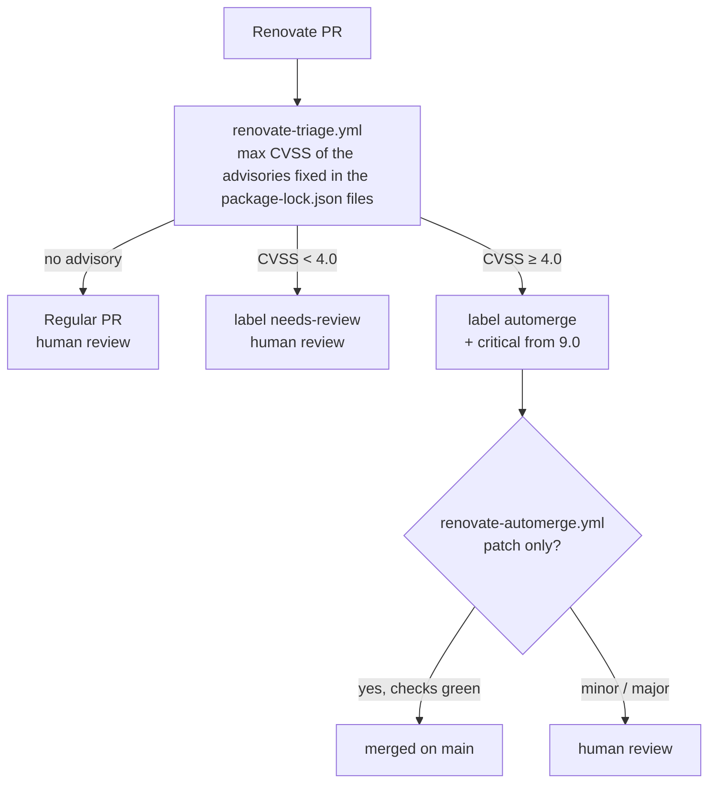

# Dependency updates (Renovate)

Dependencies are kept up to date by the hosted [Mend Renovate](https://developer.mend.io/github/algoan/nestjs-openapi-generation-benchmark)
app, configured in [`renovate.json`](../renovate.json). Security fixes are routed by the CVSS of the
vulnerabilities they fix, with the shared actions of
[`algoan/renovate-security-actions`](https://github.com/algoan/renovate-security-actions), the public
counterpart of the flow `algoan/backend` runs from `algoan/private-actions`. The **hotfix flow is off**:
nothing is deployed from this repository.

## What Renovate updates

| Manager          | Files                                                                                                  |
| ---------------- | ------------------------------------------------------------------------------------------------------ |
| `npm`            | `app/`, `bench/` and every `variants/*/` `package.json` with its `package-lock.json`                   |
| `github-actions` | `.github/workflows/*.yml`: actions, and the `node-version` of every `actions/setup-node` step          |
| `custom.regex`   | `OASDIFF_VERSION` of `refresh-nestoa.yml`; the versions quoted in `README.md` and `docs/development.md` |

A version quoted in the documentation carries a hidden marker naming the pin it mirrors, so it moves in
the same PR as the pin:

```markdown
| tsoa | 6.6.0 <!-- renovate: datasource=npm depName=tsoa --> | 300 | … |
```

- The tool versions of the **Results at a glance** tables follow the `package.json` of their variant.
  The numbers of the row are the ones of the last recorded run: the Check workflow only makes sure the
  new version has no more differences than them. Refresh the results (and the `notes` of the variant's
  `bench.json`, the comments of `docs/results.md`) when a tool's behaviour changes.
- `docs/development.md` quotes the CI Node.js version (`node-version: 26` of `check.yml` and
  `refresh-nestoa.yml`, one PR for all of them) and the `oasdiff` version of the published results
  (`OASDIFF_VERSION`, marked with a `# renovate:` comment).

Left to others, on purpose:

- `nestoa` / `@algoan/nestoa` (`variants/nestoa`): **Refresh nestoa results** installs each new
  release with its results; Renovate ignores them (it can't read GitHub Packages anyway). The
  `nestoa-main` and `nestoa-asyncapi` variants build a commit of nestoa (`bench/scripts/build-nestoa-main.sh`).
- `@nestjs/swagger` stays on 11.4.2 in `nestjs-asyncapi` and `nmime-nestjs-asyncapi`: their deep imports
  break with its later `exports` map. The existing holds stay too: no TypeScript 7.0, nestia below 12,
  typia below 13.
- `dtolnay/rust-toolchain@stable` (latest stable Rust, to build nestoa).

Updates are opened once a week (Monday before 6am, Europe/Paris), one PR per dependency: a tool bump
changes what its variant measures, and each PR re-checks only the variants it touches.

Security PRs are opened immediately, pinned to the **lowest fixing version**, without waiting for Monday.

## Routing



- **`renovate-triage.yml`** (`pull_request_target`) scores the packages changed in every
  `package-lock.json` with the GitHub Advisory Database. The highest CVSS decides the tier. For a
  security PR it sets the `security` label plus `automerge` or `needs-review` (and `critical` from
  9.0), and comments the advisories. It only runs for PRs opened by `renovate[bot]`, from the base
  commit: nothing from the PR runs with the write `GITHUB_TOKEN`, which matters on this public
  repository.
- **`renovate-automerge.yml`** merges PRs labelled `automerge` with a merge commit, like the other PRs
  here, with the `GITHUB_TOKEN`: the branch ruleset requires no approval, so no bypass app is needed. It
  recomputes the tier for the head commit, requires every commit to be authored by Renovate and signed
  by GitHub, and only accepts changes to dependency files (and lines with a `<!-- renovate:` marker).
  Only **patch** bumps merge automatically; minor/major wait for a human. Every check of the head
  commit must be green, and these must be present: `All checks` (the sum of `check.yml`) and
  `Socket Security: Pull Request Alerts`; a failed commit status (Upwind) stops it too. The triage
  starts it, and it runs again when the Check workflow completes; each run waits up to 8 minutes for
  the checks still running, then starts a new run if some still are, three times at most. It never
  merges a PR with a change request or an unresolved thread.

Not scored by the triage: GitHub Actions advisories, and the `oasdiff` binary (no CPE given): such a
security PR gets `needs-review`.

## Configuration

| Repository variable         | Default                                             | Notes                               |
| --------------------------- | --------------------------------------------------- | ----------------------------------- |
| `CVSS_AUTOMERGE_THRESHOLD`  | `4.0`                                               |                                     |
| `CVSS_HOTFIX_THRESHOLD`     | `9.0`                                               | Unused while the hotfix flow is off |
| `AUTOMERGE_REQUIRED_CHECKS` | `All checks,Socket Security: Pull Request Alerts` | Comma-separated check names         |

No secret used: the actions are public, called with `uses:` and pinned by commit SHA with the tag in
a comment, which Renovate's `github-actions` manager keeps up to date. Repository settings: Renovate app
installed, Dependabot alerts on, merge commits allowed. The ruleset must keep requiring no approval,
or the automerge can't merge with the `GITHUB_TOKEN`.
